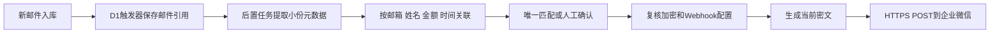

# 邮箱礼品卡关联订单与通知

更新：2026-11-17。通知已上线，当前线上配置为企业微信（version=3）；初始飞书测试记录保留在下文。

17:51 生产故障修复：旧发送器的 `redirect:'error'` 不受 Workers 支持，实际云端请求没有发出。
已发布 `db017f9`，改用 `manual` 并拒绝非 2xx；新增真实 workerd fetch 和默认发送器回归，
121 项测试通过。此前本机模拟成功不能证明云端真实发送可用；当前 3 条真实漏发通知已于 17:55
由生产定时任务发送，微信接口成功、任务均为 sent 且错误清除，没有本机代发或手工标记成功；
详细证据与进度见 [故障修复记录](webhook-incident-20261117.md)。

## 进度

| 阶段 | 状态 |
| --- | --- |
| 两封生产参考邮件的字段提取 | 完成，只读；原件仅存私有目录 |
| 邮箱、完整姓名、金额、时间的关联与去重 | 完成，共用解析器和判定规则 |
| 系统设置中的企业微信 / 飞书 Webhook | 已上线；仅加密开启时可填写，自动识别平台 |
| URL 加密保存、权限、配置版本冲突处理 | 完整地址回显已上线；只在系统设置权限内返回，不缓存 |
| D1 新邮件引用、元数据与可靠待发任务 | 迁移已执行，无历史正文补录 |
| 收信后置任务和原有每五分钟任务处理 | 已上线；17:55 生产定时任务完成 3 条真实卡通知，微信接口确认成功 |
| HTTP POST 消息体及企业微信成功/失败响应 | 本地完成，11 个真实本机 HTTP 场景通过 |
| 回归与构建 | 共 74 项 workerd 测试、23 项原型测试、前端构建及 Worker dry-run 通过 |
| 设置界面 | 完整地址回显、保存/刷新保留、失败保留输入、冲突重载、关闭后只读已验证；桌面中文/390px 手机英文通过 |
| 发件人认证 | 关联只表明邮件字段匹配，不表明身份认证；现有数据缺少可信认证，不从 From 伪造认证状态 |
| 生产发布与机器人联调 | 当前企业微信已接收模拟测试及 3 条生产邮件的加密卡通知，真实云端链路已核验 |
| 人工核对页面和回填流程 | 未实现，目前只有通知原因与来源邮件定位信息 |

## 配置与用户行为

入口：系统设置 → 卡号加密 → 邮箱卡通知，全站共用。加密默认关闭；开启后可以填写
企业微信或飞书群机器人 Webhook，保存后开始处理新到邮件。保存本身不发测试消息。

支持 `https://qyapi.weixin.qq.com/cgi-bin/webhook/send?key=…` 与
`https://open.feishu.cn/open-apis/bot/v2/hook/…`，按地址自动识别平台。
后续在同一输入框替换整个地址即可切换，无需重新部署或修改加密密码。HTTP POST 是通用传输方式，
不同平台的消息体、认证及成功响应并不通用，不能把其他平台 URL 直接替换进来。
后续平台通过独立发送适配器扩展；不允许任意地址和重定向。

Webhook URL 含机器人密钥，用现有 Worker Secret 的 AES-GCM 封装保存，使用独立用途的附加数据；
系统设置读取 API 返回完整地址、状态及版本，并使用 `Cache-Control: no-store, private`；
前端使用明文多行框，保存成功和刷新页面均保留完整地址，关闭加密仍可只读查看。
数据库继续封装保存，不在日志或公开站点配置返回地址。
修改权限沿用系统 `setting:set`，读取沿用 `setting:query`，不放入公开站点配置。

- 未填写地址时不采集通知事件、不发送消息。
- 关闭加密保留已封装地址，但取消未发送任务；再次开启只处理之后的新邮件，不补发旧任务。
- 移除/替换 Webhook 取消旧待发任务，避免旧消息发往新群；已发消息不可撤回。
- 重复保存同一规范化地址不增加配置版本、不移动采集起点、不取消待发任务；旧版本请求仍拒绝。
- 只处理配置后新入库的邮件，不补录历史邮件、不迁移或复制正文。
- 改密码保留关联元数据；发送时从已有 D1 邮件按主键取原文，以当前密码生成密文。

2026-11-17 14:37 回显更新发布：源码 `cfdea3b`，旧生产版本
`0d531e07-1be1-4dc6-9e62-b83bff99dcb5` → 新版本 `0b7fdb4d-a5d6-4324-8a60-7db52023f5d7`。
116 项 workerd 测试通过，含权限、完整地址、公开配置隔离、缓存、同地址保存及并发替换回归；
前端/Worker 构建和线上资源、未登录权限验证通过，原绑定及配置不变，无数据库迁移。
部署后将两封虚构邮件在内存数据库触发新邮件引用、匹配、生成当前策略密文，并通过同一发送适配器，
向发送时读取和复核的线上企业微信 Webhook（version=3）发出一条明确标记的测试通知，接口确认成功。
没有改用旧飞书地址，未写入生产邮件、修改密码/地址或重放历史任务；仅占用一次共享发送限额。
这是隔离模拟流程加真实机器人接口验证，真实 SMTP 到信和群内人工阅读不在本次证据中。

## 关联规则

“原始订单”指确认邮件 `Your Gift Card Order Confirmation: W…` 的 W 号。这两封邮件不足以
证明最初购物单或退款来源单；追溯更早订单需要其他明确来源。

确认邮件提取姓名、邮箱、金额/币种、数量，核对标题与正文订单号。
卡邮件从 `完整姓名 via Apple` 提取姓名，并与标题短名交叉检查；解析面值及 PIN 区域。
只识别两个确切模板与发件地址，不从任意邮件正文抓取卡号。

自动关联必须同时满足：

1. 同用户、邮箱归属和实际接收邮箱，邮箱忽略大小写。
2. 完整姓名规范化后相同，不做模糊匹配。
3. 金额及币种一致，订单和卡邮件均明确一张卡。
4. 确认邮件在卡邮件前 24 小时至后 30 分钟内。
5. 唯一候选且单卡订单未被其他卡占用，不选“最近一封”猜测。
6. 没有来自可信适配器的明确认证失败；未知认证不阻止邮件字段关联，也不算认证通过。

关联用于通知中定位另一封确认邮件，并不认证订单真伪、不执行兑换或付款。
当前 D1 无法提供完整可信认证，代码不从 From 或任意 Authentication-Results 推导认证通过。
前一原型要求认证通过才关联，这会导致实际邮件全部转人工；当前按用户指定字段做唯一关联，
将身份认证和记录关联分开。后续可从可信平台来源增加独立认证结果。
本机两封参考邮件的邮箱、姓名、金额可提取且一致，时间差 12 分 45 秒；该检查不证明发送者认证。

## 流程、索引与耗时



收信 INSERT 触发器仅为两个 Apple 发件地址记录邮件 ID 和配置版本，原文仍在原邮件表。
同时按原始收件时间检查激活边界，避免配置前或关闭期间的缓冲邮件在稍后入库时被补发。
引用和原邮件同事务提交，进程中断不会丢掉通知任务；附件保存未完成时先等待，通知失败不影响收信。
提取后 `gift_mail_event` 保存邮箱、姓名、金额/币种、时间、订单号及问题码等小份数据。
复合索引 `(config_version,kind,owner_key,recipient_key,person_key,currency,amount_minor,received_at)`
用于关联，最多 21 个候选；匹配不扫描正文。一次最多解析 100 条引用、处理 15 条待发任务，
20 秒执行预算，余量持久保留；未完成入库/提取的引用会暂缓关联，避免漏看竞争候选。

卡邮件至少等待 2 分钟；缺订单等待至收卡后 30 分钟，再转人工。既有每五分钟任务负责兜底，
因此正常通知并非即时，通常在等待期结束后的下一次任务发送，还会受队列/限流影响。
姓名、数量、币种或卡号不明确，明确认证失败，或多候选、多卡抢单，均不自动确认。
发送前重查关联；已发通知不因晚到邮件自动撤回或修正。

去重摘要是 Secret 上带独立用途前缀的 HMAC，独立于保护密码，改密不重建索引。
元数据和队列不存原卡号、密码或旧密文；发出前再次读加密状态、版本、目的地址版本和关联结果。
加密材料或配置不可用时保留任务，不回退原卡号。

## 通知与投递

正常示例（虚构样本）：

```text
收到新的邮箱卡
原始订单：W1000000001
邮箱卡号：JG_XDEM_A01J1DVRTQWT_ABCD
面值金额：$149.95
收件时间：2026-11-16 18:40:00（北京时间）
```

人工通知将订单改为“未关联（需人工确认）”，附原因、邮箱和来源邮件 ID。
卡号不能唯一解析时仅写“未识别（需人工处理）”，绝不发送未处理正文。

内部使用统一文本体，发送适配器转换为各平台格式。企业微信请求体：

```json
{"msgtype":"text","text":{"content":"通知正文"}}
```

飞书请求体：

```json
{"msg_type":"text","content":{"text":"通知正文"}}
```

成功必须 HTTP 2xx，企业微信 `errcode` 为数字 `0`；飞书 `code` 为数字 `0`，
或无 `code` 时旧协议 `StatusCode` 为数字 `0`。HTTP 200 的业务错误也失败。
单次请求/响应读取限制 8 秒，响应最多 4 KiB，不跟随重定向，不保存下游错误原文。
共享 D1 租约避免两个实例同时消费；每分钟最多预留 18 次请求，低于机器人 20 次额度。
失败退避重试，最多 8 次，耗尽保留 `failed` 记录供运维处理；没有自动清理或后台重试按钮。
可按当前配置版本只读检查 `gift_notification` 的 `state/attempts/last_error/sent_at`，不要输出 URL 或正文。

企业微信群机器人不支持我们的自定义幂等键。消息已到群但成功响应丢失时，重试可能重复。
早期 WS 原型的接收侧去重不能套用到这里；本机 HTTP 模拟明确展示 2 次请求、2 条消息。
设置关闭与外部已接受请求之间无法实现跨平台事务，关闭不能撤回已在途或已发送的消息。

## 本地复现与上线边界

需要 Node.js 24，在 `mail-worker` 运行：

```sh
pnpm run gift-order:test
pnpm run gift-order:simulate
pnpm test
../d1-backup-worker/node_modules/.bin/wrangler deploy --dry-run
```

默认模拟器仅访问本机随机 HTTP 端口，采用企业微信消息体和成功响应；全部通知身份数据虚构。
23 项原型测试保留早期本机 WS 接收侧去重案例，实际 HTTP/D1 路径另由 23 项新增测试覆盖。
生产参考原件仅在 `.private/gift-order-simulation/source-samples.json`，含敏感数据，严禁提交或打包。
报告只输出去身份化字段检查和虚构通知，位于同目录的 `results.md/results.json`。

生产迁移 `20261116_gift_webhook.sql` 仅新增表、索引和触发器，已于 2026-11-16 执行。
源码 `194ae19`；旧版本 `dc0479ef-3e36-4d87-8462-fa819b0eb8ce`，
21:43 发布新版本 `e6aedae6-b4d8-49d6-856f-668516c67168`。
21:44 封装保存临时飞书地址，configured/active、provider=feishu、配置 version=2；
21:45 一条明确标注测试、不含真实订单或卡号的通知获飞书成功响应。后续同一设置框替换完整企业微信地址即可。
平台绑定、普通变量、Secret 名称、自定义域与 Cron 核验一致，保护仍开启/version=8，未修改保护密码。
生产首页、公开配置、未登录的新配置接口权限拒绝与构建资源检查通过。
本次按已授权 CLI 运维，通过同一后端配置服务写入 D1（封装密钥已与现有生产运行材料验证一致）；
未重置管理员密码或创建登录会话，未进行生产登录后的 UI 保存操作。飞书连通性由实际发送适配器验证，
真实新卡收信到 Worker 再到群的端到端链路尚待自然到信核验；没有插入模拟邮件。
迁移依赖既有卡号保护表；不需要新 Secret、队列或定时策略。
回滚代码不能撤销数据库触发器：回滚前移除 Webhook，停止新增引用并取消待发任务；新增表可保留。
未运行生产正文补录，尚未验证实际企业微信群或生产高峰负载。
